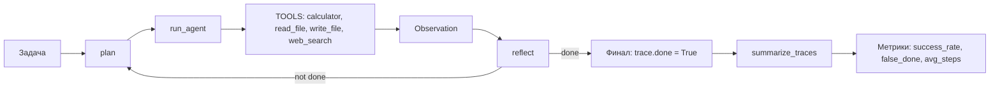

# Mini Agent

Мини-агент с инструментами, реализующий паттерн ReAct.

## Что умеет
- Калькулятор
- Чтение файла
- Запись файла
- Поиск в интернете (заглушка)

## Архитектура
1. Мысль — модель решает, какое действие выполнить.
2. Действие — вызов инструмента.
3. Наблюдение — результат инструмента.
4. Повтор до завершения задачи.

## Как запустить
python3 src/agent.py

## Автор
redsea1970

## Оценка

Тестовый набор: 5 задач (3 распознаваемых планировщиком, 1 без записи в файл, 1 нераспознаваемая).

| Режим | success_rate | false_done | avg_steps |
|---|---|---|---|
| Без рефлексии | 0.8 | 0 | 1.0 |
| С рефлексией | 0.6 | 1 | 1.0 |

**Интерпретация:** без рефлексии агент «верит», что задача выполнена, даже если результат не записан. С рефлексией он честно фиксирует `false_done: 1` (задача «Посчитай 15% от 200» без записи в файл) и не засчитывает её. Это ожидаемый компромисс: рефлексия снижает `success_rate`, но не даёт агенту врать о завершении.

## Ограничения

- Планировщик `plan()` — эвристический (по ключевым словам), а не LLM. В демо-режиме без API.
- `reflect()` — тоже эвристический, проверяет наличие действия в `steps_done`, а не реальный результат.
- Метрика `false_done` считается только в режиме с рефлексией (без рефлексии агент не проверяет цель).
- Для production нужно: заменить планировщик и рефлексию на LLM с промптами (CoT + Reflexion), добавить проверку результатов инструментов, логировать траектории в структурированном виде.

## Архитектура

## Архитектура

Подробная схема проекта: [ARCHITECTURE.md](ARCHITECTURE.md)
